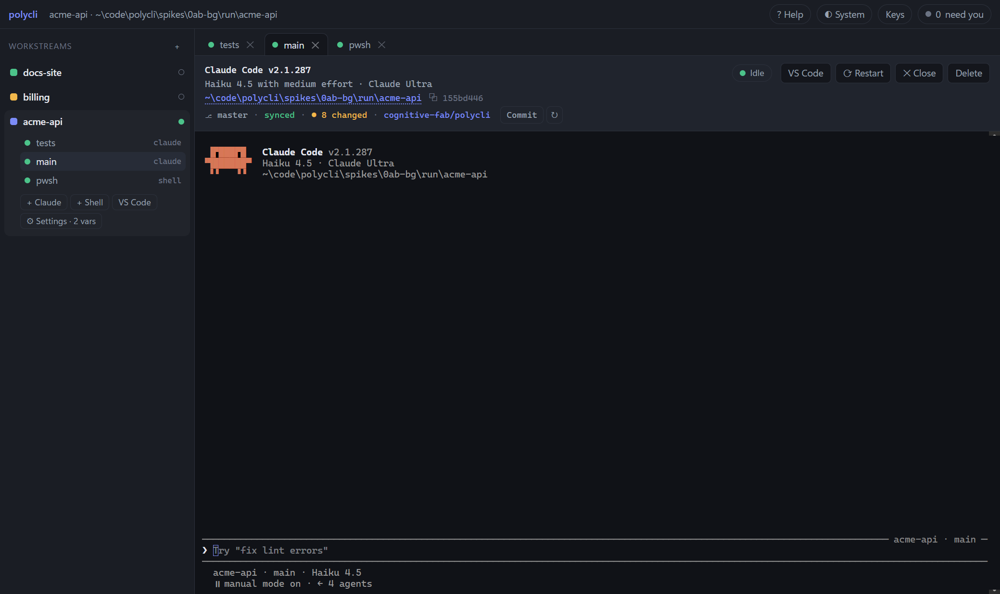
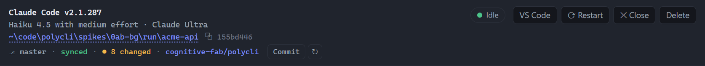
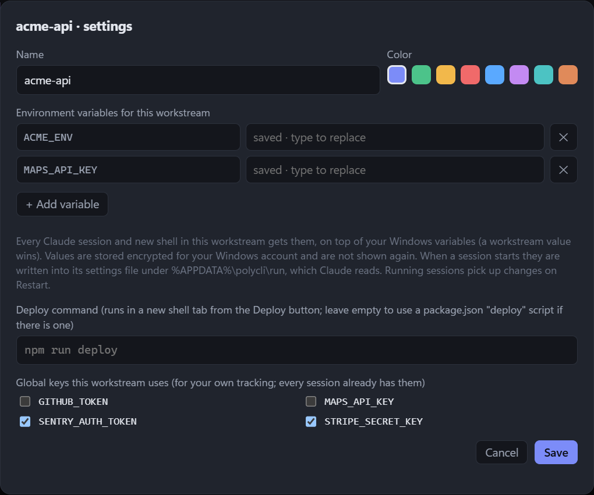
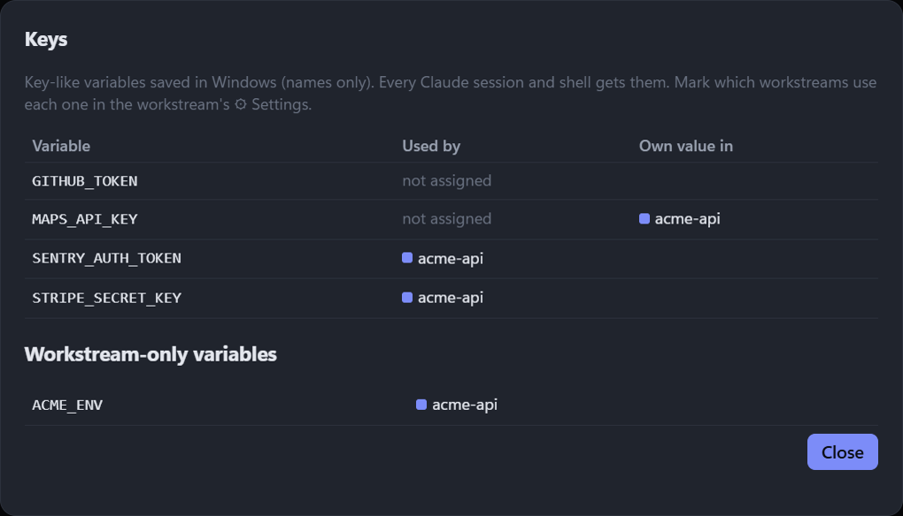
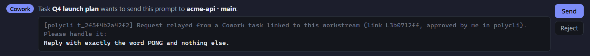
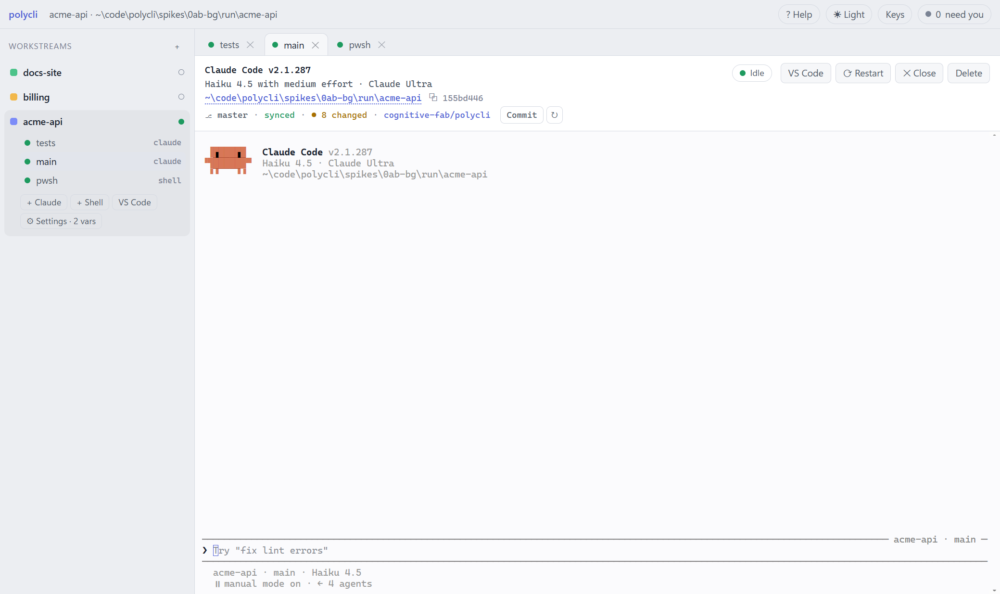

# polycli help

polycli keeps your Claude Code sessions and shells organized by **workstream**, one window for all of them.

## Workstreams

A workstream is one piece of work: a name, a color and a main folder. Its Claude sessions and shells are listed under it in the left rail. Click **+** next to *Workstreams* to create one.

- The dot after a name shows the most urgent state inside it: **yellow** needs you, **blue** working, **green** idle.
- Under the active workstream: **+ Claude** starts a session, **+ Shell** opens PowerShell in the folder, **VS Code** opens the folder, **⚙ Settings** edits the name, color, environment variables and deploy command.
- Closed sessions are kept under **Closed (n)**. Click one to reopen it with its conversation.

## Claude sessions

**+ Claude** asks for a role (the session is named "workstream · role"), a folder, a model and an effort. Each session is a Claude Code *background* session shown in a tab:

- It **keeps running when polycli closes**, and polycli reconnects to it when it starts again.
- **✕ Close** stops it but keeps the conversation; it moves to *Closed*.
- **⟳ Restart** restarts it on the current Claude Code version with the same conversation. Use it after changing the workstream's environment variables.
- **Delete** removes the session and its conversation.
- Everything Claude Code does works as usual inside the tab. Pressing **←** on an empty prompt opens Claude's agent view.

## The session header

1. **Claude Code version**.
2. **Model and effort**, then your plan.
3. **Folder.** Click to open it in VS Code (**Shift**: the git repository root, **Ctrl**: a new VS Code window). A **worktree** tag appears when the session moved into a git worktree (see below). The **⧉ id** copies `claude attach <id>`.
4. **Git line** (only in a git repository): branch, sync state, changed files, the GitHub repository, the pull request and its checks, and the **Commit**, **Push** and **Deploy** buttons.

## Worktrees

A git *worktree* is a second working folder for the same repository, checked out on a different branch. Claude Code can create one (in `.claude\worktrees\<name>` inside the repository) to work on a branch in isolation: your main folder and its branch are untouched while Claude works, and the work comes back through a merge or a pull request.

When a session moves into a worktree, the header shows that folder with a **worktree** tag, the branch shown is the worktree's branch, and VS Code opens the worktree. Hover the folder to see where the session started.

## Git: Commit, Push, Deploy

- **Commit** lists the changed files, stages them (`git add -A`, optional) and commits with your message. Your git hooks and signing run as usual. **Ask Claude to commit** lets the session write the message and commit instead.
- **Push** asks first and shows what will be pushed. A branch that isn't on GitHub yet shows **Publish**. polycli never force-pushes; if GitHub rejects the push, you see git's message.
- **Commit** and **Push** are disabled while Claude is working, so you don't commit half-edited files.
- **Deploy** appears when the workstream has a deploy command (**⚙ Settings**), or when `package.json` has a `deploy` script. It asks first, then runs in a new shell tab so you see the output. It never runs again by itself.
- **↻** refreshes the git and pull request information. It also refreshes after each Claude turn and every 20 seconds.

## Needs you

When Claude needs a decision (a permission prompt, for example), the session turns **yellow**, the **need you** counter in the top bar goes up, and the taskbar button flashes when polycli isn't in front. Click the counter to jump to the session.

## Shells

**+ Shell** opens PowerShell in the workstream folder, with the workstream's environment variables. Shells end when polycli closes and new ones open in the same folders when it starts again; their history isn't kept.

## Copy and paste

- **Drag** to select text, then **Ctrl+C** to copy. With nothing selected, Ctrl+C goes to Claude as usual.
- **Ctrl+Shift+C** always copies and never reaches Claude.
- **Ctrl+V** pastes. The mouse wheel scrolls Claude's conversation.

## Continue in another terminal

Click the **⧉ id** in the header to copy `claude attach <id>`, and run it in any terminal. A session can only be attached in one place, so that terminal takes it over and the tab shows **Take back**. The conversation is the same in both places.

## Environment variables and keys

- **⚙ Settings → Environment variables**: name/value pairs given to every Claude session and new shell of the workstream, on top of your Windows variables. Values are stored encrypted and never shown again. Running sessions pick up a change on **Restart**; the tab tells you when one is needed.
- Variables that start with `ANTHROPIC_` or `CLAUDE_CODE_USE_` change how Claude itself signs in and bills, and polycli warns about them.
- **Global keys this workstream uses**: tick the Windows key variables the workstream relies on, for your own tracking.

**Keys** in the top bar lists the key-like variables saved in Windows (names only), which workstreams use each one, and which workstreams set their own value.

## Cowork bridge

Cowork tasks can work with your polycli sessions: link to a workstream, send prompts to its Claude sessions and read the answers, start new sessions for parallel work, and report the artifacts and documents they produce.

**Set up once.** Click **Cowork** under a workstream, then **Install or update the extension…**. The Claude desktop app opens its install dialog for the **polycli bridge** extension (it says the extension is unsigned); install it. polycli must be running for Cowork to reach it.

**In a Cowork task**, ask for it in plain words, for example: *"Use the polycli tools: link this task to the acme-api workstream, then ask the main session to run the tests and tell me the result."*

1. **Link.** The task asks to link; a **Cowork** bar appears above the tabs. Pick the workstream and click **Link**, or **Reject**. Several requests can be rejected at once, or muted for 15 minutes.
2. **Prompts.** Each prompt the task wants to send appears in the bar, in full, with the target session. Click **Send** or **Reject**.

3. **Delivery.** polycli types the prompt into the session when it is idle (never while you are typing in it), with a first line saying which Cowork task sent it. The tab shows **◇ From Cowork** while it runs, and the answer goes back to the task.
4. **Permission prompts** inside the session are still yours to answer in polycli; the Cowork task waits.

**Policies** (workstream **⚙ Settings**): prompts from Cowork can be sent without asking, and new sessions it requests can start without asking (only in the workstream folder). Prompts that start with `!`, `/`, `#` or `@` always ask.

The **Cowork** panel of a workstream lists the linked tasks (with **Revoke**), the artifacts and documents they reported (**Open link**, **Show file**), and their recent prompts and answers.

## Themes

The top-bar button cycles **System**, **Light** and **Dark**. System follows Windows.

## Troubleshooting

- **"Trust needed"**: Claude Code hasn't trusted the folder yet. Answer its prompt in the tab, then type `/exit`; polycli starts the session.
- **"Detached"**: the tab lost its connection while the session kept running. polycli reconnects by itself; **Reattach** does it now.
- **No pop-up notifications**: Windows only shows them for an installed app. In a development run (`npm start`) the taskbar button flashes instead.
